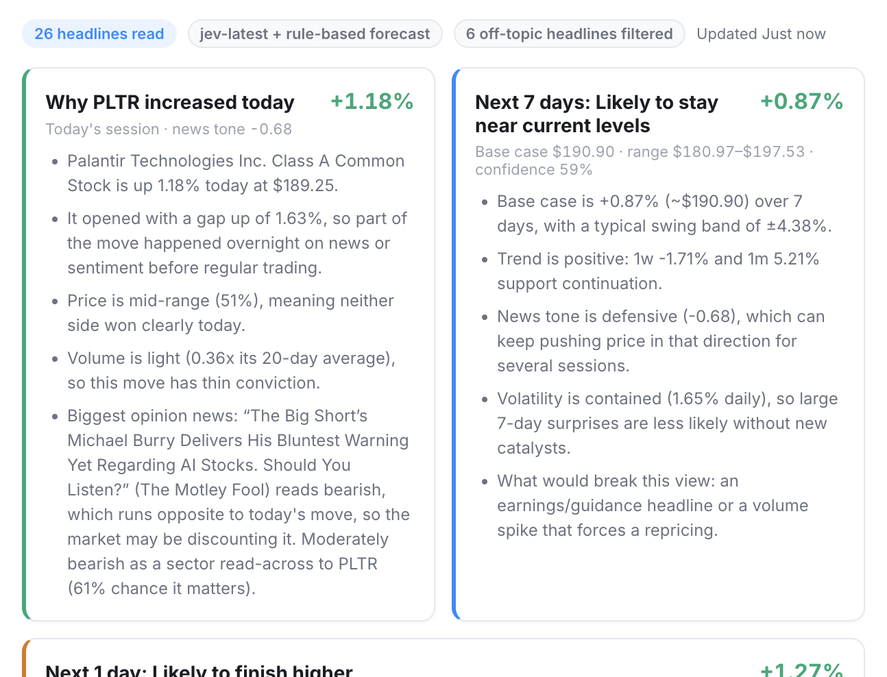
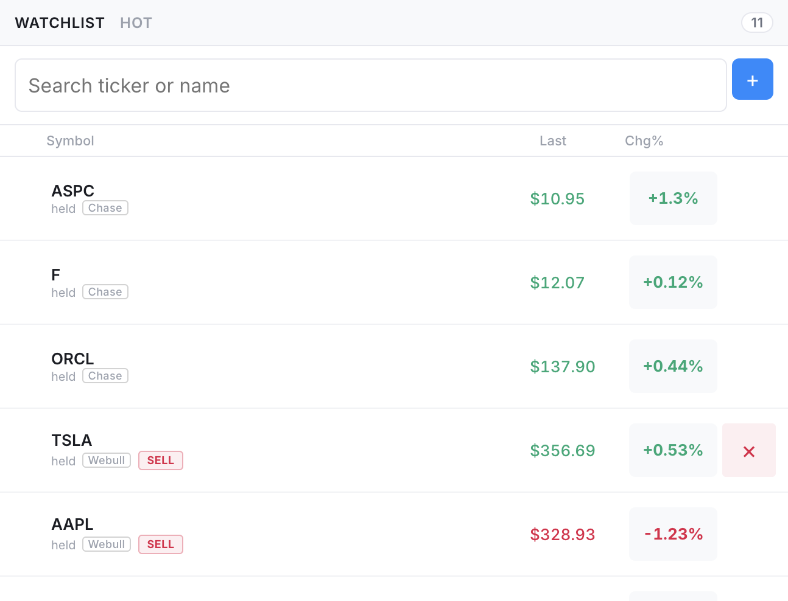
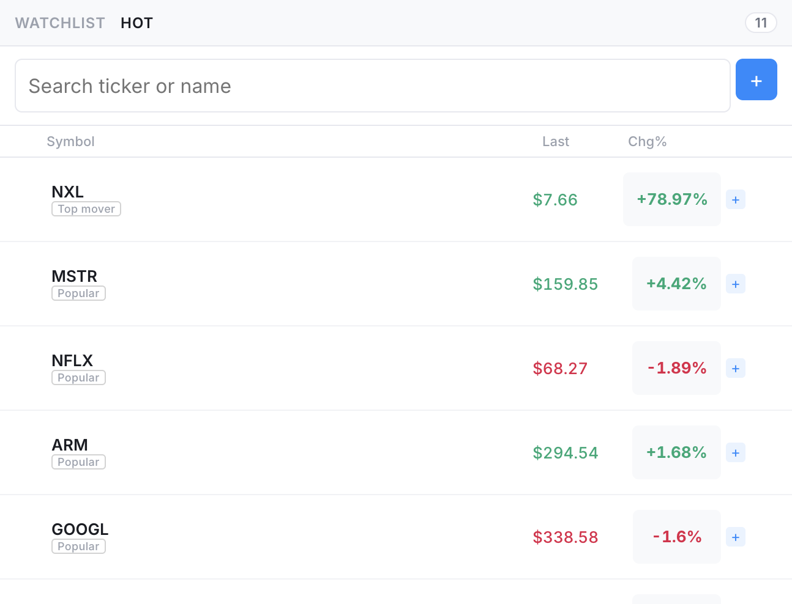
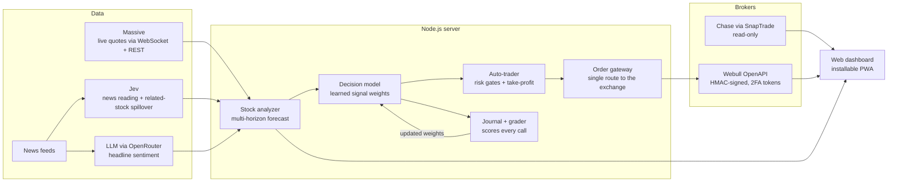

# TouqiaO — AI Stock Analysis & Auto-Trading Platform

TouqiaO is a real-time trading dashboard that explains why a stock moved today, forecasts where it is likely to go next, and can trade on those forecasts through a live brokerage account under strict risk limits. Every prediction it makes is logged, graded against what the market actually did, and fed back into the model.

> **Source code is private.** This repository is a showcase of the design and results. Code walkthroughs are available for interviews on request: catherinezhou00@gmail.com

## Screenshots

**AI analysis.** Clicking any Chg% value explains today's move from the price action and the news, then forecasts the next day, three days, week, and month.

| Unified portfolio across brokers | Hot list of popular stocks and top movers |
| --- | --- |
|  |  |

Holdings from Chase and Webull appear in one list, each tagged with its broker. Webull positions can be sold in one click with a confirmation step; Chase is connected read-only. The Hot tab ranks widely traded stocks by today's move and adds the day's top gainers, filtered to real common stocks with enough price and volume to trade.

## Architecture

## How it works

**Forecasting.** For each stock, the analyzer combines recent price momentum and volatility, news sentiment scored by an LLM, and spillover from news about related companies. The result is a base case, a likely range, and a confidence level for four horizons: one day, three days, one week, and one month.

**Decisions.** A weighted score of those signals is compared against learned buy and sell thresholds. The weights are not hand-tuned constants: they move as predictions get graded.

**Self-grading loop.** Every call is written to a journal with the signals behind it. After the next trading session closes, the grader scores the call against that session's closing price, skipping any call made on simulated or stale quotes, and nudges the weights toward the signals that were right. A shadow benchmark also asks the LLM for a direct up/down call on the same stocks, so the learned model is continuously compared against "just ask the AI".

**Autonomous trading.** On a fixed interval during market hours, the auto-trader re-analyzes a watchlist and only acts on the clearest signals. Risk controls are layered:

- Per-order, daily-spend, and daily-order-count caps, enforced in one order gateway that every trade must pass through.
- Buys use settled cash only, so the account can never be overdrawn.
- A cooldown stops repeated trading in the same stock.
- A per-lot ownership ledger means the robot only ever sells shares it bought itself, never the user's own or promotional shares.
- Intraday take-profit: a position that is well up and has little forecast upside left is sold rather than left to give the gain back.
- A dry-run mode runs exactly the same decision path as live trading, so a preview can never promise a trade the live system would refuse.
- Live trading is off unless two separate switches are explicitly enabled.

## Tech stack

Node.js (ES modules), vanilla JavaScript PWA, WebSocket and Server-Sent Events streaming, REST APIs with HMAC-SHA1/SHA256 request signing, OpenRouter LLMs, Massive market data, Webull OpenAPI, SnapTrade.

## Status

Connected to a live Webull cash account, sized at about $10 per order. The prediction journal and accuracy scoreboard are still accumulating graded calls; accuracy figures will be published here once the sample covers enough trading days to be meaningful.
